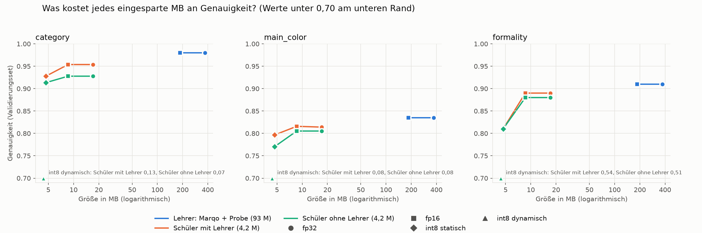

# ClosetLens

Ein digitaler Kleiderschrank: Kleidung fotografieren, automatisch freistellen und beschreiben lassen,
durchsuchen, Outfits vorschlagen – und langfristig Outfits an einem 3D-Avatar anprobieren.

> Status: **M7 – Verkleinern** fast fertig (Distillation und int8 gemessen, Marqo-int8 fehlt noch), als Nächstes M8 (siehe [LERNPFAD.md](LERNPFAD.md))

## Architektur

```
 Handy/Browser ──► Frontend (mobile-first, heller Lookbook-Stil)
                        │ HTTP
                        ▼
                  api/      FastAPI – nur Ein-/Ausgabe
                        │
                  services/ Fachlogik
                   │            │
            storage/         jobs/      eine GPU-Warteschlange
         SQLite + Dateien       │
                          models/   Schnittstellen: BackgroundRemover · AttributeRecognizer ·
                                    Embedder · TryOn · Avatar (+ Fakes für Tests)
```

Jedes Modell steckt hinter einer Schnittstelle (`typing.Protocol`) und ist austauschbar,
ohne dass API oder Datenbank sich ändern.

## Datenschutz

- Alles läuft lokal im Heimnetz, ohne Login.
- Fotos von mir dürfen auf gemietete Cloud-GPUs, Fotos anderer Personen nie.
- Fotos, Datenbank und Modellgewichte sind per `.gitignore` vom Repo ausgeschlossen.

## Einrichtung

```bash
# Mac
python3.12 -m venv .venv
.venv/bin/python -m pip install -r requirements.txt

# Windows (PowerShell) – in requirements.txt rembg[gpu] statt rembg[cpu] verwenden
py -3.12 -m venv .venv
# PyTorch mit CUDA zuerst, sonst installiert pip die CPU-Version
.venv\Scripts\python -m pip install torch torchvision --index-url https://download.pytorch.org/whl/cu128
.venv\Scripts\python -m pip install -r requirements.txt
# onnxruntime passend zu PyTorchs CUDA 12.8 (ab 1.27 ist es für CUDA 13 gebaut und fällt still auf die CPU zurück)
.venv\Scripts\python -m pip install "onnxruntime-gpu==1.26.*"
```

Außerdem: [Ollama](https://ollama.com) mit einem Vision-Modell, z. B. `ollama pull qwen2.5vl:3b`.

## Starten

```bash
.venv/bin/uvicorn wardrobe.api.main:app --host 0.0.0.0 --port 8001
```

- Am Rechner: <http://127.0.0.1:8001/>
- Am Handy im selben WLAN: `http://<IP des Rechners>:8001/` (Mac: `ipconfig getifaddr en0`)
- `--host 0.0.0.0` macht den Server im Heimnetz erreichbar. Ohne diese Option antwortet er nur dem Rechner selbst.
- JSON-API und Testoberfläche: <http://127.0.0.1:8001/docs>
- Tests: `.venv/bin/python -m pytest`

## Auswertung (M4)

Wie gut erkennt das lokale VLM (`qwen2.5vl:3b` über Ollama) die Attribute? Gemessen auf einem eingefrorenen Testset
aus dem öffentlichen Datensatz *Fashion Product Images* (Studiofotos eines Online-Shops).

| Attribut | n | Abdeckung | Genauigkeit (95 %-Intervall) | Macro-F1 | Label-Fehler laut Audit (+ strittig) |
|---|---|---|---|---|---|
| category | 831 | 100 % | **86 %** (83–88) | 0,86 | 0 % (+2 %) |
| main_color | 1182 | 100 % | **67 %** (64–69) | 0,69 | 4 % (+14 %) |
| formality | 200 | 12 % | 83 % (64–93) | 0,75 | 0 % (+7 %) |

1,9 s pro Bild auf einer RTX 2070.

**Methodik**
- **Labels:** Die Labels des Datensatzes werden auf die eigene Taxonomie abgebildet ([label_mapping.py](wardrobe/evaluation/label_mapping.py)).
  Unklare Werte wie „Tops“, „Kurtas“ oder „Orange“ werden ausgeschlossen statt auf „other“ gelegt.
- **Gruppen:** Produkte, die sich nur in der Farbe unterscheiden, bilden eine Gruppe (Name ohne Farbwörter). Gruppen liegen
  komplett im Test- oder im Trainingsteil, damit ein späteres eigenes Modell (M6) keine Geschwister der Testbilder sieht.
- **Stichprobe:** pro Attribut ausgeglichen (bis 100 pro Klasse), höchstens ein Produkt pro Gruppe und Klasse, fester Seed.
  Kleine Klassen behalten mindestens die Hälfte ihrer Gruppen fürs Training.
- **`null`-Antworten** zählen nicht als Fehler. Die Abdeckung wird getrennt angegeben (selektive Klassifikation).
- **Label-Audit:** 100 Testbilder, modellgestützt geprüft. Drei Fehler in der Zuordnung wurden danach behoben.

**Ergebnisse im Detail**
- Größter Kategoriefehler: T-Shirts werden zu 55 % als „shirt“ erkannt, meist Polos.
- Bei Farben weicht das VLM oft auf „multicolor“ aus.
- `formality` beantwortet es kaum.

**Einschränkungen**
- Studiofotos statt Handyfotos, oft mit Model, das mehrere Kleidungsstücke trägt.
- Etwa jedes fünfte Farb-Label ist strittig.

**Reproduzieren**
```bash
python -m scripts.prepare_dataset                        # Datensatz laden
python -m scripts.make_test_set                          # Testset einfrieren (Seed 0)
python -m scripts.run_recognizer --model qwen2.5vl:3b    # VLM-Lauf, fortsetzbar
python -m scripts.evaluate --run qwen2.5vl-3b            # Bericht nach data/evaluation/
```

## Zero-Shot mit Embeddings (M5)

Statt das VLM zu fragen, werden Bild und kurze Texte („shirt“, „a photo of a blue colored garment“) in denselben
Vektorraum eingebettet. Gewählt wird der Text mit der höchsten Kosinus-Ähnlichkeit ([zero_shot.py](wardrobe/models/zero_shot.py)).
Gleiches Testset wie in M4:

| Attribut | VLM qwen2.5vl:3b | Marqo-FashionSigLIP | SigLIP2 B/16-384 |
|---|---|---|---|
| category | 86 % (83–88) | **93 %** (91–94) | **93 %** (91–94) |
| main_color | 67 % (64–69) | 75 % (72–77) | 76 % (73–78) |
| formality | 83 % bei 12 % Abdeckung | 77 % bei 100 % | 81 % bei 100 % |
| Zeit pro Bild (RTX 2070) | 1,9 s | **0,01 s** | 0,03 s |

**Methodik**
- **Klassentexte** wurden nur auf einem eigenen Validierungsset getunt (783 Bilder aus den Trainingsgruppen,
  [make_validation_set.py](scripts/make_validation_set.py)) und danach einmal auf dem Testset gemessen.
- Das bloße Wort („t-shirt“) trennt T-Shirt und Hemd viel besser als „a photo of a t-shirt“:
  T-Shirt → Hemd fiel von 36–44 auf 7–8 von 100. Bei der Farbe blieb vom Gewinn auf dem Validierungsset (+3 Punkte)
  auf dem Testset nur etwa 1 Punkt übrig.
- „other“ ist keine wählbare Klasse. Zero-Shot antwortet immer, deshalb ist die Abdeckung bei formality 100 %.
  Es kann dabei „smart“ antworten, das im Testset nicht vorkommt und immer als Fehler zählt.

**Einschränkungen**
- Marqo wurde vermutlich auch auf diesem Datensatz trainiert (Marqo misst selbst auf „KAGL“), die Zahl ist eher zu optimistisch.
- Zero-Shot erkennt keine Marke.

**Reproduzieren**
```bash
python -m scripts.make_validation_set
python -m scripts.run_recognizer --recognizer zero-shot --model hf-hub:Marqo/marqo-fashionSigLIP [--set validation]
python -m scripts.evaluate --run marqo-fashionSigLIP [--set validation]
```

## Eigener Klassifikator (M6)

Zwei Wege, Marqo auf die eigenen Attribute zu trainieren, beide nur auf den Trainingsgruppen:
- **Linear Probe** ([linear_probe.py](wardrobe/training/linear_probe.py)): Marqo bleibt eingefroren, pro Attribut eine
  logistische Regression auf den einmal berechneten Embeddings. Trainiert in Sekunden auf der CPU.
- **Partielles Feintuning** ([finetune.py](wardrobe/training/finetune.py)): Die letzten 2 der 12 ViT-Blöcke lernen mit,
  je ein Kopf pro Attribut, Label Smoothing 0,1. 5 Epochen in 8 Minuten auf einer RTX 2070.

Gleiches Testset wie in M4 und M5, einmal gemessen:

| Attribut | VLM qwen2.5vl:3b | Zero-Shot Marqo | Linear Probe | Feintuning |
|---|---|---|---|---|
| category | 86 % (83–88) | 93 % (91–94) | **96 %** (95–97) | **96 %** (95–97) |
| main_color | 67 % (64–69) | 75 % (72–77) | 76 % (74–78) | **77 %** (75–79) |
| formality | 83 % bei 12 % Abdeckung | 77 % (70–82) | 90 % (85–93) | **94 %** (90–97) |
| Zeit pro Bild (RTX 2070) | 1,9 s | 0,01 s | 0,02 s | 0,05 s |
| VRAM | 2,8 GB (laut `ollama ps`) | 0,85 GB | 0,85 GB | 1,6 GB |
| Training | – | – | Sekunden (CPU) | 8 min (GPU) |

**Ergebnisse**
- Beide trainierten Modelle schlagen VLM und Zero-Shot deutlich bei category und formality, bei main_color nur knapp.
- **Probe gegen Feintuning:** bei category gleich (7 gegen 8 Bilder, die nur einer richtig hat). Bei main_color hat das
  Feintuning 41 Bilder richtig, die der Probe falsch hat, umgekehrt 29: Das ist kein gesicherter Unterschied
  (McNemar p ≈ 0,15). Bei formality 8 gegen 0 (p < 0,01), allerdings bei nur 200 Bildern.
- **Vom Validierungs- zum Testset fallen alle Verfahren ab**, die trainierten bei main_color stärker (−6,5 bis −7 Punkte)
  als Zero-Shot (−5). Was auf dem Validierungsset ausgewählt wird, ist dort immer etwas zu gut gemessen.
- Der Rest bei main_color liegt zum Teil an den Labels: Laut Audit ist etwa jedes fünfte Farb-Label falsch oder strittig.

**Methodik**
- Alle Entscheidungen (C des Probes, Anzahl Blöcke, Label Smoothing, Wahl des Feintuning-Laufs) fielen auf dem
  Validierungsset. Ausgewählt wurde der günstigste von vier gleichauf liegenden Feintuning-Läufen (siehe LERNPFAD).
- Gewichtung seltener Klassen bei beiden Verfahren gleich (`class_weight="balanced"` bzw. dieselbe Formel im Loss).
- Pattern und material kommen bei Probe und Feintuning weiter von Zero-Shot.
- VRAM bei den PyTorch-Modellen: Spitzenwert von `torch.cuda.max_memory_allocated`, ohne den CUDA-Grundbedarf.

**Einschränkungen**
- Studiofotos, keine Handyfotos. Ob die Genauigkeit auf eigenen Fotos hält, ist noch offen.
- Das feingetunte Modell passt nicht mehr zum Textturm. Textsuche und ähnliche Teile müssen das Original-Marqo nutzen.

**Reproduzieren**
```bash
python -m scripts.cache_features                 # Embeddings aller Produktbilder, einmalig
python -m scripts.train_probe --save             # Grid Search über C, speichert die Probes
python -m scripts.learning_curve                 # Genauigkeit über Beispiele pro Klasse
python -m scripts.finetune --label-smoothing 0.1 --run marqo-last2-ls   # [--method lora]
python -m scripts.run_recognizer --recognizer probe --model hf-hub:Marqo/marqo-fashionSigLIP --run probe
python -m scripts.run_recognizer --recognizer finetuned:marqo-last2-ls --model hf-hub:Marqo/marqo-fashionSigLIP --run finetuned
python -m scripts.evaluate --run probe           # bzw. --run finetuned
```

## Verkleinern (M7)

Wie viel Genauigkeit kostet ein kleineres, schnelleres Modell? Drei Wege, alle auf demselben Validierungsset gemessen:
- **Weniger Bits pro Gewicht:** fp16 (2 statt 4 Bytes) und int8 (256 Stufen) mit ONNX Runtime
  ([export.py](wardrobe/compression/export.py)). Dynamisch rundet nur die Gewichte vorab, statisch auch die
  Zwischenwerte, mit Skalen aus 100 Trainingsbildern.
- **Ein kleineres Modell (Distillation):** MobileNetV3 mit 4,2 M statt 93 M Parametern lernt von den Labels und von den
  Antworten des großen Modells ([distill.py](wardrobe/training/distill.py)). Lehrer ist Marqo mit den Linear Probes aus M6.
- **Vergleich:** derselbe Schüler einmal ohne Lehrer (`alpha=0`), einmal mit (`alpha=0.7`, Temperatur 4).



| Modell | Format | Größe | CPU | MPS | category | main_color | formality |
|---|---|---|---|---|---|---|---|
| Lehrer: Marqo + Probe | PyTorch fp32 | 372 MB | 46 ms | 18 ms | 0,980 | 0,835 | 0,910 |
| | fp16 | 186 MB | 189 ms | 17 ms | 0,980 | 0,835 | 0,910 |
| | ONNX fp32 | 373 MB | 87 ms | – | 0,980 | 0,835 | 0,910 |
| Schüler mit Lehrer | ONNX fp32 | 17 MB | 5,0 ms | 6,0 ms | 0,954 | 0,814 | 0,890 |
| | ONNX int8 statisch | 4,7 MB | **2,2 ms** | – | 0,928 | 0,796 | 0,810 |
| Schüler ohne Lehrer | ONNX fp32 | 17 MB | 4,7 ms | 5,8 ms | 0,928 | 0,805 | 0,880 |
| | ONNX int8 statisch | 4,7 MB | 2,2 ms | – | 0,913 | 0,770 | 0,810 |

Zeiten pro Bild (Batch 1, Median) auf einem Mac: CPU mit ONNX Runtime, MPS = Apple-GPU mit PyTorch. Auf einer RTX 2070
braucht das feingetunte Marqo 11 ms (fp32) bzw. 13 ms (fp16), mit identischer Genauigkeit.

**Ergebnisse**
- **fp16 kostet nichts:** gleiche Antworten, halbe Größe. Schneller wird es nur auf passender Hardware, auf der CPU ist
  fp16 vier- bis zehnmal *langsamer*, weil dort keine fp16-Rechenwerke sitzen.
- **Distillation hilft:** Der Schüler ohne Lehrer macht bei category 3,6-mal so viele Fehler wie der Lehrer, mit Lehrer
  nur 2,3-mal so viele (0,928 → 0,954). Er lernt auch schneller: nach Epoche 1 schon 0,90 statt 0,83.
- **Der Schüler mit int8** ist 80-mal kleiner und auf der CPU 20-mal schneller als der schnellste Lehrer-Lauf (46 ms)
  und verliert bei category 5 Punkte.
- **Dynamisches int8 zerstört MobileNet** (category 0,13): Es ist für Transformer gebaut. Bei Faltungen werden die
  Zwischenwerte pro Bild über Min/Max gerundet, ein Ausreißer macht die Stufen unbrauchbar grob.
- **Auch statisches int8 braucht die richtige Kalibrierung:** Mit MinMax fiel category auf 0,63, mit mehr
  Kalibrierungsbildern sogar auf 0,14 (mehr Chancen für Ausreißer). Percentile, das die äußersten 0,001 % ignoriert, hält 0,93.
- **Das Format entscheidet über die Zeit:** MobileNet in PyTorch auf der Mac-CPU 113 ms, in ONNX Runtime 5 ms.

**Methodik**
- Validierungsset (783 Bilder), nicht das Testset: Kalibrierungsmethode und `alpha` wurden hier ausgewählt.
- Jede Variante wird genau einmal trainiert (ein Seed). Der category-Effekt der Distillation ist groß genug, um
  wahrscheinlich echt zu sein; bei main_color und formality (100 Bilder, 1 Bild = 1 Punkt) liegt er im Rauschen.
- Lehrer-Logits kommen aus den gecachten Marqo-Features (unaugmentiert), der Schüler sieht zufällige Ausschnitte.
  Der Lehrer hat die Trainingsbilder selbst gesehen und ist dort etwas zu selbstsicher.

**Einschränkungen**
- int8 für Marqo ist noch nicht gemessen (zu speicherhungrig für den Mac, läuft auf dem PC).
- Die Schüler kennen nur category, main_color und formality. Pattern, Material, Textsuche und ähnliche Teile brauchen
  weiterhin Marqo.

**Reproduzieren**
```bash
python -m scripts.train_probe --save                               # Lehrer (braucht scripts.cache_features)
python -m scripts.distill --alpha 0.0 --run mobilenet-labels       # Schüler ohne Lehrer
python -m scripts.distill --alpha 0.7 --run mobilenet-distill      # Schüler mit Lehrer
python -m scripts.benchmark [--models mobilenet-distill ...]       # Größe, Zeit, Genauigkeit -> m7_benchmark.csv
python -m scripts.plot_m7                                          # docs/m7_curve.png
```
